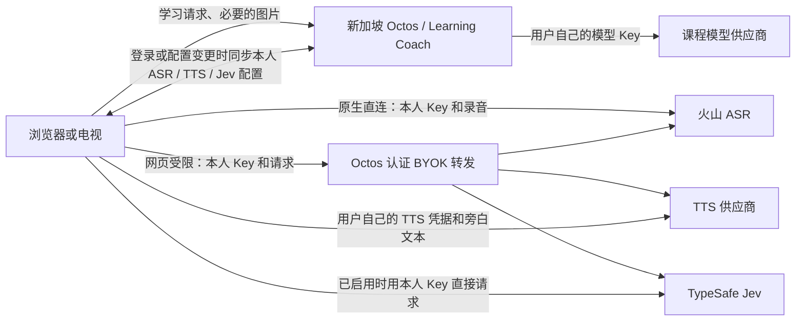

# 全面 BYOK 与首次使用体验实施方案

日期：2026-10-19（America/Los_Angeles）。状态：已开始分支实施，见[候选实现与验收记录](FULL_BYOK_IMPLEMENTATION_STATUS.md)；未调用真实付费供应商、合并或部署。

## 1. 已确定的方向与执行边界

用户已确定：课程生成、ASR、TTS、Jev 全部使用用户自己的服务与凭据，覆盖浏览器和电视 APK；Jev 是可选能力，未配置时仅停用对应功能，不影响其他能力。首次使用、缺少配置、配置失效和恢复过程必须形成完整 UX。

本次修订将凭据和服务配置统一归入 Octos 管理，替代初稿的“语音凭据只在当前设备保存”设计。统一管理与调用执行位置分别设计。2026-10-19 修订：语音首期仅支持火山新版 API Key；网页直连受限时允许经现有 VPS 转发，电视保留原生直连，Jev 同样遵循该规则。

本方案采用以下具体解释：

- **BYOK 表示调用费用和凭据属于用户，不等于所有模型调用都搬到浏览器。** 浏览器和电视发起的课程生成继续由新加坡 Octos / Learning Coach 使用当前用户的模型 Key 执行，保持现有课程生成链路及网络出口。
- Octos 按账号统一保存课程模型、ASR、TTS 和可选 Jev 的配置与本人凭据；设备同步本人配置；Android 原生层直接调用供应商，网页直连不可用时使用认证后的 Octos BYOK 转发。平台不下发共享凭据。
- 服务端继续负责认证、用户隔离、凭据管理、课程生成、课程和图片数据；产品部署退出旧平台代付、平台语音额度及私有 worker 依赖。Octos 增加通用、受限的 BYOK 转发，不包含学习产品判断规则，不从环境或其他账号获取凭据。
- 学生的识别文字可以作为学习请求发送给课程服务器；摄像头、选区图片仍按现有学习流程上传。电视录音直接发送给火山；网页录音在直连受限时经过 VPS 转发，不写入课程历史或服务器语音缓存。
- 初版不增加服务器、国内网关、跨区域票据或电视配对服务；不实施上一轮未合入的流式 ASR 补丁，不恢复 TTS 白名单补丁。
- 用户已授权从最新 main 创建新分支实施，但未授权合并 main；实施在独立分支中进行，不默认合并、部署、购买资源或更改其他仓库可见性。

### 必须守住的门槛

1. 课程首个可播放片段的生成速度优先：同模型、同请求交错基线 p50 不回退，课程调用路径零新增模型往返。
2. 配置问题只影响相应能力：缺语音不阻止文字课程，缺模型不阻止手写白板和已有课程。
3. 平台不承担任何隐藏的 AI 调用费用；所有辅助模型路径均须盘点，不只检查课程主模型。
4. 用户凭据不进入 Git、构建变量、日志、诊断、白板快照、课程 JSON、导出或遥测。
5. 浏览器与 APK 均须真实完成 BYOK 识别和播放；只通过预检、只通过 APK 或只隐藏入口不算完成。

## 2. 当前实现与实际改造范围

检查基于 octos-learn `aa58422` 和本地 learning-coach 主线；历史部署文档中的状态不能直接作为本次验收结论。

| 当前实现 | 本期处理 |
|---|---|
| 模型设置保存在账号 profile，Coach 按调用开始时的路由快照运行 | 保留，完善输入与错误恢复 UX，核实各辅助调用也使用本人 Key |
| SetupWhiteboard 含平台免费旁白、SharedTtsPanel，缺独立 ASR 配置 | 三项学习能力加可跳过的 Jev 增强设置 |
| VoiceTab 的个人 TTS 保存到服务端 profile | 保留 Octos 管理方向，补齐通用 ASR、Jev 配置、凭据隔离与客户端执行契约 |
| native-config 从产品 sidecar 下发语音配置，可能回退平台凭据 | 替换为 Octos 仅面向本人配置的同步接口，去掉共享凭据回退 |
| NativeTtsBridge 能直连并加密保存；NativeAsrBridge 借用它的凭据 | 复用传输基础，分离 ASR / TTS 的配置、就绪和清除行为 |
| getVoiceRouting 聚合私有、本地、托管语音状态 | 结合 Octos 配置状态与本设备真实可用状态；不把服务端语音 readiness 当成客户端直连成功 |
| 语音失败可以上传 WAV 给服务器做 ASR | 改为显式的本人 Key BYOK 转发，不恢复旧平台 / 私有 ASR 回退；保留文字输入 |
| hosted-TTS 有账本、音频缓存、ASR、Jev grant / evaluate | 先迁出客户端依赖，再停服务；不能直接关闭进程 |
| Jev 从平台 grant / VITE_TYPESAFE_API_KEY 获取 Key，evaluate 实际仍使用服务器平台 Key | 迁入 Octos 的可选本人凭据；无配置时直通，不隐式替换为其他模型 |
| CoursePack 自带旁白、生成课缓存音频 | 保持播放；新生成语音缓存在当前账号的本机空间 |

## 3. 目标架构与数据归属

| 数据 | 保存和处理位置 | 是否跨设备 |
|---|---|---|
| 课程模型 Key / 模型选择 | 现有账号服务端凭据体系；客户端输入后不保留明文副本 | 同一账号沿用现有行为 |
| ASR / TTS 凭据、服务和音色选择 | Octos 账号凭据存储；客户端仅获取本人使用所需配置 | 可同步本人设备 |
| Jev 凭据、模型与启用状态 | Octos 账号凭据存储；本人设备按用途同步所需 Key 并直接调用供应商 | 同一账号共享配置 |
| 语音与 Jev 测试状态 | 测试对应配置版本、实际执行位置和环境 | 不将其他设备的成功当成本机成功 |
| 原始录音 | 本机短时内存；电视直连火山，网页跨域受限时经 VPS 转发 | 不在服务器持久化，不进入课程记录 |
| 识别文字 | 本机显示后进入现有学习请求及必要的历史记录 | 按现有课程历史规则 |
| 新合成音频 | 本机缓存，按账号、供应商、音色、文本和配置版本隔离 | 不自动上传音频 |
| CoursePack 打包音频 | 既有静态课程资源 / APK 内嵌资源 | 保持现有分发方式 |

服务器分发已有课程包里的音频不等于为用户调用 TTS；本期保留静态内容分发。

### 服务端模型凭据的正确边界

保留现有 profile 隔离与原子路由快照。新课程使用保存后的配置，进行中的课程保持原路由，不在中途混用 Key。不得因服务器进程中存在 GEMINI_API_KEY、OLL_* 或其他平台凭据而给缺少本人配置的用户兜底。公网候选列表只显示已通过课程结构化生成验证的模型能力；通用聊天连接成功不等于可以生成 OLL 课程。

实施时同步改写 AGENTS.md 的 BYOK 条款：平台停止语音和 Jev 代付；Octos 统一管理本人凭据；平台共享密钥永不进入终端；用户自己的 ASR / TTS / Jev 凭据允许按身份同步到终端并直连。该规则由本轮用户方向替代旧的托管语音约定，不再要求白名单例外。

## 4. 首期供应商与调用路径

- ASR、TTS 仅支持火山引擎新版 `X-Api-Key` 鉴权；不展示 Azure 或旧版 App ID / Access Token 选项。资源 ID、TTS 音色仍单独配置。旧版凭据不得作为新版 Key 复用，迁移时要求重新填写。
- Jev 保留 TypeSafe System One，本人 Key、可选启用。
- 电视新版 APK 使用受限原生 HTTP 适配器直连固定官方地址；不因鉴权或上游错误自动切换收费路径。
- 2026-10-19 检查：火山当前 TTS V3 / 极速 ASR 的浏览器预检未放行 `X-Api-Key`，Jev 未允许本站来源。因此当前网页直接选用 VPS 转发，避免每次先发送一次可能计费的直连 POST，再重试。
- 后续若官方接口允许浏览器直连，先以无凭据预检及真实请求确认成功、错误响应和必需响应头可读，再改变该接口的路径选择；不根据一个宽泛网络错误自动重复付费调用。
- VPS 不改变费用归属，始终使用调用者提交的本人同步配置或未保存测试草稿中的 Key。服务只允许三组固定 capability/provider 地址，不接受 URL、任意请求头、平台凭据或跨账号 credentialRef。
- `POST /api/my/client-services/{capability}/relay` 复用 Octos 本人身份验证；请求上限 8 MiB、上游响应上限 12 MiB、30 秒上游超时、禁止重定向、无自动重试，响应不缓存。供应商 HTTP 错误放在响应 envelope 内，避免与 Octos 登录失效混淆；不返回供应商错误正文。
- 网页设置与录音测试说明“请求可能经服务器转发”，不能继续宣称录音永远不经过服务器。

历史无凭据接口检查见[火山预检](byok-migration-2026-10-19/browser-preflight.json)和[其他供应商预检](byok-migration-2026-10-19/direct-provider-preflight.json)。Azure 检查仅为历史研究，不表示首期提供 Azure。

## 5. 一套共享的能力状态，替代“有 Key 就算可用”

四个能力独立维护，设置页、onboarding、工具栏和运行时提示使用同一来源：

- 课程生成 `lesson`。
- 听讲解 `tts`。
- 语音输入 `asr`。
- 可选输入预判 `admission`（Jev）。

状态建议：`unconfigured`、`configured_unverified`、`checking`、`ready`、`invalid_credentials`、`resource_not_enabled`、`quota_exhausted`、`rate_limited`、`network_error`、`environment_unsupported`；另外独立记录麦克风权限、播放手势要求、用户主动静音，不把设备权限问题归为 Key 错误。

规则：

- 保存配置和通过真实测试是两件事；未测试显示“已保存，尚未测试”，不是“连接正常”。
- 就绪快照绑定 account、provider、configRevision、端能力和测试时间；切换账号、清空配置、修改音色 / 模型 / 接口后失效。
- ready 不是永久保证；首次真实业务失败更新状态，不在每次请求之前增加测试请求。
- 429 先按限流处理；只有供应商明确返回余额或额度错误才显示“额度用尽”。浏览器 fetch 失败不能确定是跨域还是网络，提示可诊断的组合原因，不误报 Key 无效。
- 未配置语音也不轮询私有服务、不申请 RTC 会话、不请求平台 status、不下载大型语音 SDK。
- 切换模型 / 语音配置时，进行中任务采用启动快照；新任务使用新配置，配置删除 / 退出账号立即取消相应本机语音任务。

## 6. Onboarding：先开始学习，可选增强稍后配置

### 6.1 入口

初次进入简洁说明：“AI 讲解、语音输入和旁白使用你自己的服务，费用由对应供应商账户承担。”提供：

- “体验已有课程”：保持现有课程访问规则；打包旁白不需要 Key。
- “配置 AI 讲解”：进入课程模型设置。
- “先用白板”：跳过配置，继续手写与浏览。

不把注册 / 登录、麦克风权限和供应商开通三类流程混成一个长表单，不改变现有账号访问政策。

### 6.2 模型卡：生成新课程需要

显示供应商、支持的课程模型、凭据输入与“如何获取凭据”官方链接。默认只显示必要字段；自定义服务地址放高级设置，并说明地址的归属与凭据发送对象。

- 主按钮“保存并测试”；显式说明测试可能产生少量供应商用量，不虚构具体费用。
- 复用当前 `/api/my/test-provider` 与 profile 保存语义；测试失败保留输入草稿，不覆盖已工作的配置。
- 连接成功与课程模型兼容分别显示：连接由真实请求判断，兼容性由已验收 registry 判断。可选“生成一节试课”是真实课程，计入用户用量，不在后台偷偷再生成。
- 保存已持久化、运行时未生效时，显示“已保存，尚未生效”及实际可执行的重试方式，不显示完成。
- 模型 Key 文案：“用于服务端课程生成，保存在你的账号设置中，不写进白板和课程。”

### 6.3 听讲解卡：可选

文案：“连接自己的语音服务，让老师读出讲解；稍后也可只看文字。”

- 填本人 TTS 凭据，选一个与资源权限匹配的音色。
- 主按钮“保存并试听”；使用固定短句“这是你的课堂旁白。”，只能由显式点击触发。
- 先区分合成成功与播放成功。浏览器阻止自动播放时显示“语音已生成，点此播放”，不重复合成。
- 提供“稍后设置”，不拦截模型设置或进入白板。
- 凭据说明：“由 Octos 保存在你的账号中，同步到你登录的设备，用于设备直连语音服务；调用费用由你的供应商账户承担。”

### 6.4 语音输入卡：可选

文案：“连接自己的识别服务，把说出的题目转成文字。”

- ASR 单独配置和测试，不因为 TTS 成功就标记 ASR 成功。
- 可选择复用同一账号下同一供应商的本人凭据，建立 Octos credentialRef；用户知情后复用，分别验证资源权限。
- “录一小段测试”才申请麦克风，显示录音状态、停止按钮、识别文字和“录音仅发送给你选择的识别服务”。默认停止即清理本机测试录音。
- 权限被拒绝保留配置，指引浏览器 / Android 系统权限入口，提供继续打字。
- 不因第一次测试成功而自动开启持续监听。

### 6.5 Jev 输入预判：可选增强

设置中提供“输入预判（Jev，可选）”，说明：“帮助过滤无关口语、判断是否需要补充问题。未连接也能正常生成课程。”支持保存、由当前设备显式测试实际调用路径、启用 / 停用和删除，不要求新用户填写，不把它纳入进入白板的完成条件。测试可能产生本人供应商用量。

### 6.6 完成页与再次进入

显示三项实际结果，例如“AI 讲解已连接 / 听讲解未设置 / 语音输入未设置”。“进入白板”始终可用；不使用“全部完成”掩盖跳过项。

Jev 单独显示“输入预判未启用 / 已连接 / 暂时不可用”，默认收起，不因未配置弹窗、不在每次提问时催配。

已有模型配置的老用户只展示可跳过的语音迁移说明，不重复填写模型 Key。跳过状态不是功能可用状态；清空 / 失效后仍能在触发功能时得到就地帮助。首次体验提示按账号与设备记录，避免每次登录都完整重走向导。

## 7. 未配置时的就地提示与恢复

| 用户动作 | 缺少什么 | 展示与后续 |
|---|---|---|
| 输入问题后点击生成 | 课程模型 | “连接自己的课程模型后即可生成”；按钮“去连接模型”“继续写白板”；保留原问题 |
| 框选笔迹 / 摄像头图片后生成 | 课程模型 | 保留当次选区快照或图片引用，配置后提供“继续这次提问”，不要求重拍重选 |
| 点击麦克风 | ASR | 小面板解释需要自己的识别服务，按钮“配置语音输入”“改用文字”；不先申请麦克风 |
| 点击语音提问，模型与 ASR 都缺 | 两项 | 同一面板列出两项依赖，先配置课程模型；可明确选择“只转写成文字”后仅用 ASR，避免连环弹窗 |
| 课程正在播放但没有 TTS | TTS | 正常播放画面和文字；音量区域轻提示“当前为文字讲解”，提供“配置旁白”，不逐句弹窗 |
| 用户明确点击听讲解 | TTS | 就地打开 TTS 设置；保留当前课程及播放位置 |
| 仅有 TTS，点击语音输入 | ASR | 清楚说明“旁白已连接；语音输入仍需配置”，不笼统报语音服务未就绪 |
| 麦克风被拒绝 | 设备权限 | 显示权限修复指引和“继续打字”，不让用户重填 Key |
| 供应商确认凭据失效 | 对应凭据 | “当前凭据不可用”；“检查配置”“重新测试”，保留输入与课程状态 |
| 供应商明确额度用尽 | 供应商账户 | “你的语音服务额度不足”，提供供应商控制台入口；不显示本站充值或平台额度 |
| 网络 / 跨域失败 | 网络或兼容性 | “当前环境未能连接该服务”；重试、诊断或更换已支持服务，不承诺重填 Key 就能解决 |
| 图片上传或课程服务失败 | 学习请求 | 使用原有上传 / 课程错误处理，不误导用户去配语音 |
| 正常提问但未配置或停用 Jev | 可选输入预判 | 直接进入既有学习流程；不弹配置阻断，不声称已完成 Jev 过滤或澄清 |
| 已启用 Jev 但凭据失效、限流或超时 | 可选输入预判 | 本次跳过预判继续学习，设置区显示状态和修复入口；不自动用课程模型代替 |

恢复必须遵守：

- 从功能按钮打开小面板 / 抽屉，不把学生直接带离白板；电视使用大字号、焦点可达的表单，支持遥控器与触摸。
- 通过安全的 actionId 引用本机待恢复上下文，不在 URL 放 Key、原始录音或大段题目；检查账号、过期时间和原选区是否仍适用。
- 配置成功后提供一次明确的“继续上次请求”，不自动提交付费课程、恢复旧麦克风或反复弹出权限框。
- 待恢复任务以 actionId 去重；配置过程中更换账号就丢弃原待恢复任务。切回白板不重复生成课程。
- 持续录音时状态区分“正在听 / 正在识别 / 正在生成课程 / 正在播放”；停止后丢弃迟到识别与旁白结果。
- 提示不盖住输入框、选区工具栏、主要数学画面和遥控焦点。

## 8. Octos 统一凭据管理与设备缓存

### Octos 的通用管理边界

- 各能力配置关联当前用户 / profile 下的 credentialRef、provider、model / resource、executionTarget、enabled 和 configRevision；Jev 固定为客户端执行，其 System One 协议由客户端独立适配，不能只填入通用 OpenAI-compatible 模型列表。
- 普通配置读取只返回掩码、引用和状态；新增仅供已认证本人设备使用的直连配置获取能力，按 ASR / TTS / Jev 用途返回必要的本人凭据，不开放任意 env_vars 导出。服务端使用的课程模型 Key 不随客户端配置同步返回。
- 本人直连配置获取接口禁止公共缓存、日志及遥测记录响应，校验账号归属和用途。跨账号、无凭据、已删除凭据必须拒绝，绝不回退进程环境或管理员共享 Key。
- 现有 Octos 代码不能证明所有 API Key 已受系统钥匙串或加密存储保护。实施时必须核实公网 Linux 的秘密存储、权限、备份及迁移；不能把当前 profile env_vars 当作已完成的通用安全凭据库。
- 登录、配置变更及必要的版本同步时准备 ASR / TTS / Jev 运行快照，不在每次识别、每句话合成或每次 Jev 预判前请求新加坡获取 Key。设备已准备的快照可供当前任务使用；同步失败时如实显示配置状态。
- 删除或更换凭据使已连接客户端的相应版本失效并清理缓存；退出时关闭任务。离线设备已经获得的供应商长效 Key 不能仅靠 Octos 删除就彻底撤销，真正失效仍需供应商侧撤销。

### 浏览器

- 从 Octos 获取的本人 ASR / TTS / Jev 凭据默认只放当前会话内存；可显式勾选“记住在这台设备”。本机缓存使用按本站 origin + accountId 分区的 IndexedDB，不放 localStorage、不进 service worker 通用缓存。账号主配置仍在 Octos。
- 清楚说明浏览器持久保存无法防御同源恶意脚本；本期不以“前端再加密一次”宣称绝对安全。配置区域不引入第三方脚本，诊断不采集输入框与请求鉴权头。
- 退出账号立即清理内存、关闭麦克风、取消网络请求并清除本机秘密缓存，后续登录重新按身份同步。“清除此设备缓存”与“从账号删除配置”必须区分，前者不删除其他设备可用的账号主配置。
- 私密模式、存储禁用或空间不足时，回退仅会话保存并明确提示，不假报已记住。
- 跨标签页配置变更和退出通过不含凭据的事件通知；新标签页校验当前身份与配置版本后准备快照，不广播 Key。

### Android

- 使用 Android Keystore 加密凭据；用户填写时表单短暂持有输入，保存后 JS 只持有本机凭据引用、掩码和状态，原生方法只接收供应商专属的必要参数，不成为任意带 Key 的 HTTP 代理。
- ASR / TTS / Jev 分离配置命名空间、schemaVersion、账号作用域与资源权限；复用一组本人凭据时删除前提示另一能力也受影响。
- 当前设备已有从平台下发的配置必须按“来源未知旧配置”清除，不能悄悄标记成用户自带 Key；保留内嵌和已缓存课程音频。
- 配置入口支持粘贴和显隐；清除后 UI 与原生 isConfigured 一致。Key 不进 APK、Gradle 参数、二维码 URL、剪贴板日志或未加密导出。
- 退出账号释放原生任务并清除对应原生秘密缓存，不跨账号自动启用。卸载 / 换机后重新登录并同步本人账号配置，在新设备验证权限、网络与播放能力。

## 9. 本人 BYOK 调用运行时与语音缓存

建议新增 `src/learning/capabilities/`、`src/voice/providers/` 和 `src/voice/credentials/`；目录名可在实施时贴合现有结构调整。对上层只暴露少量接口：

- `getCapabilityState(capability, accountScope)`：返回本配置状态与可执行修复动作。
- `testCapability(configDraft, signal)`：显式测试，不修改正在工作的配置。
- `saveCapabilityConfig(configDraft)` / `clearCapabilityConfig(capability)`：通过 Octos 保存 / 删除本人配置并刷新版本；普通读取保持掩码，本机缓存单独清理。
- `prepareClientCapabilitySnapshot(capability, accountScope)`：按身份获取本人 ASR / TTS / Jev 直连所需配置并准备端内快照，不作为每次业务调用的前置网络请求。
- `AsrClient.transcribe(audio, configSnapshot, signal)`：第一期兼容现有断句 WAV；返回最终文字或 no_speech。
- `TtsClient.synthesize(text, configSnapshot, signal)`：返回可播放音频或经验证的流式适配器；播放 started / ended 由实际播放器上报。
- `JevClient.evaluate(input, configSnapshot, signal)`：电视直连 System One，网页受限时调用认证 BYOK relay；返回现有预判结果，不恢复旧平台 evaluate / sidecar。

实施要点：

1. 优先适配现有 VAD、Android 原生采音、音频播放器、取消和预取机制，不重写白板、OLL 或 Coach。
2. 供应商直连不携带本站 Cookie / Token；本站 relay 使用认证 API client。两条路径均固定官方 HTTPS 地址，禁止重定向和任意地址。
3. 取消、页面关闭、退出账号、删除配置均释放麦克风、连接、定时器和播放。供应商开始处理后取消不承诺免计费。
4. 第一期开通可工作的断句 ASR，不恢复已放弃的独立 hosted 流式服务；将来若做原生流式，是用户凭据直连的独立优化。
5. TTS 若先完整缓冲再播放须如实记录首声耗时。支持 HTTP Chunked 不等于播放器已经边收边播；流式播放可独立迭代，不能借“流式”命名冒充已完成优化。
6. 新音频缓存键包含账号、供应商、资源、音色、语速、格式、文本和非秘密配置版本；凭据不写进键、文件名或 metadata。播放前校验身份，公共电视不能播出前一账号的私有音频。
7. 保留下一句预取和同一请求合并；不在未配置 / 静音状态后台合成，不在失败时切到另一家未获用户选择的收费供应商。
8. 无 ASR 时仍可打字；ASR 完成后只提交文字与必要图片，网页 WAV 只允许进入新的认证 BYOK relay，不走旧平台识别 / legacy admission。语音失败保留当前本机录音供显式重试，默认不长久保存。
9. 无 TTS 或 TTS 失败不冻结课程播放器，保留文字、数学动画与手动推进。动画启动基于真实音频 started，重放和取消不改变 OLL 数学语义。

## 10. Jev：由 Octos 管理的可选 BYOK 能力

需要逐项核对课程计划、分节生成、图片理解、选区分类 / 辅助、标题及 Jev 等辅助调用的凭据归属。用户本人模型 Key 应覆盖现有 Coach 工作流，不因 UI 标记 BYOK 就默认全部路径已经合规。

### 10.1 当前功能与凭据问题

`admission-fast-gate.ts` 中 Jev 根据文字和视觉上下文标记判断是否生成课程、追问或忽略输入，同时返回学科与输入是否完整。它不读取选区 / 相机像素，不能替代 Coach 的图片理解；当前学科结果也不能视为课程路由能力。

当前 Key 来自 `VITE_TYPESAFE_API_KEY` 或 `/api/systemone/grant`。虽然客户端请求可以附带 Authorization，`services/hosted-tts/server.mjs` 的 evaluate 路由实际仍从服务器 `config.typesafeApiKey` 取 Key。因此，仅新增个人 Key 输入框不会形成 BYOK。

### 10.2 已确认的产品行为

| Jev 状态 | 行为 |
|---|---|
| 未配置或用户停用 | 跳过 Jev，保留空输入等本机检查后进入原有课程流程；不阻断、不请求 grant、不用其他模型补偿 |
| 本人已配置并启用且当前设备支持直连 | 使用已同步的本人 Key，由当前设备直接调用 Jev；保留相应过滤与前置澄清 |
| 网页直连受跨域限制 | 经 VPS BYOK relay 使用本人 Key 调用 Jev；只有转发失败或超时才跳过预判 |
| Key 失效、额度不足、限流、网络失败或超时 | 更新 Jev 状态，本次按现有 passthrough 行为继续学习；不使课程模型、ASR 或 TTS 变为不可用 |

未配置确实会缺少 Jev 提供的口语噪声过滤、意图判断和前置澄清，产品应如实说明。Coach 原有理解能力保留，但不承诺它等价补齐这些功能，也不额外调用 Gemini 模拟 Jev。用户正常点击生成仍可能发生本人课程模型用量；跳过 Jev 不代表课程免费。

### 10.3 配置与执行契约

1. 在 Octos 增加可选的 TypeSafe Jev 凭据引用、模型、启用状态和版本；测试由当前设备发起，电视直连、网页受限时经 Octos BYOK relay。默认未启用，用户配置并启用后使用。不要求填写以完成 onboarding，不和 ASR / TTS 或课程模型共用一个可用性布尔值。
2. 将旧平台 evaluate 改为本人 BYOK 调用。电视使用受限原生直连；网页受限时使用认证 Octos relay。上游请求不带本站 Cookie / Token。Octos 只向已认证本人设备同步 Jev 所需配置与本人 Key，普通设置读取保持掩码。
3. 一次输入最多执行现有的一次 Jev 预判；未配置时本机已有状态直接跳过，不临时探测配置。已启用时使用有限超时、取消与去重，禁止串行自动重试或再增加一个 LLM 分类请求。迁移后按相同 Jev 开关状态比较首段 p50，不承诺可选预判本身没有耗时。
4. Jev 的 questions、过滤阈值、澄清文案和白板输入业务留在 octos-learn；客户端负责协议调用与本机可用状态。Octos 负责通用配置、凭据管理、身份隔离、配置同步及受限转发，不内置学习产品专属题目规则。
5. 先完成本人 Key 的真实调用、失效及跨账号隔离验证，再移除 VITE_TYPESAFE_API_KEY、平台 grant / evaluate、sidecar 依赖和旧平台凭据。不能将旧平台 Key 静默迁移成用户凭据。

浏览器和电视的 Jev 直连均须在实施前验证：检查官方接口的实际成功 / 失败响应 CORS、鉴权、超时、目标电视网络与 Key 同步边界。当前尚未验证，不能因代码中的 `jev_direct` 名称就认定已经直连。网页直连不可用则验证 VPS 转发；转发也不可用时跳过可选 Jev 并继续学习。未完成真实调用前不宣称已验收。

### 10.4 必须验收

覆盖未配置、已停用、本人成功、错误 Key、超时、限流、账号切换、删除和迟到结果。至少用两个账号的独立模拟凭据确认上游实际使用各自 Key，并验证服务器存在平台环境变量时仍不会兜底。对短主题、口头填充、指代不明、选区公式、摄像头题目、旁白回声和打断分别回归；未配置时允许缺少 Jev 语义判断，但空输入检查、原有图片理解与正常课程生成仍须可用。

## 11. 改动清单与多仓库边界

| 位置 | 具体工作 |
|---|---|
| `src/learning/setup-whiteboard.tsx` / `setup-state.ts` | 三项学习能力加可选 Jev 设置，跳过与就地恢复，共享能力状态 |
| `src/settings/voice-tab.tsx` / `shared-tts.tsx` | Octos 本人 ASR / TTS 配置与本设备测试，产品移除平台额度 UI |
| `src/settings/llm-*` / `lesson-model-errors.ts` | 真实课程能力过滤、模型保存状态、Key / 限流 / 网络错误文案 |
| `src/api/voice-routing.ts` / `voice.ts` / `cloud-asr.ts` | 供应商客户端分离，停止旧 hosted / private / 平台 speech 回退，网页接入本人 relay |
| `src/home/use-ominix-runtime-summary.ts` | 改为本机语音能力摘要，模型状态单独显示 |
| `src/home/voice/use-voice-conversation.ts` | BYOK transcript 进入原有学习快路径，替换旧平台 WAV 识别为本人 BYOK relay，保留取消与去重 |
| `src/learning/oll/use-oll-narration-tts.ts` | 用户 TTS、缓存、预取和无声播放，CoursePack 音频保持优先 |
| `android/.../NativeTtsBridge.java` / `NativeAsrBridge.java` / `MainActivity.java` | 本机配置管理、账号隔离、独立语音权限和来源迁移 |
| `admission-fast-gate.ts` / `systemone-grant.ts` / `typesafe-client.ts` | 接入 Octos 本人 Jev 配置同步与客户端直连，移除平台 grant / evaluate 调用；验证可选与错误直通行为 |
| `octos` 的 profile、秘密存储、API / OUP | 通用 ASR / TTS / Jev 配置、本人直连配置同步及严格 BYOK 隔离；新增固定地址的认证 BYOK relay，允许网页兼容转发 |
| `.env.*` / `vite.config.ts` / `deploy/` / `scripts/` | 清理产品语音开关、代理、平台凭据和旧 Jev 路由；不将用户 Key 写入 VITE_* |
| `services/hosted-tts` 及 hosted-ASR 部署 | 先保留用于迁移，再退役；不删除用量数据库和备份来假装完成退出 |
| `docs/README.md`、AGENTS、onboarding、部署手册、E2E 清单 | 同步新的费用、凭据、调用位置、支持矩阵和退役步骤 |

本期需要 octos-learn 与 Octos 协作：Octos 补齐通用配置、凭据管理与执行契约，octos-learn 承担学习产品 UX、Jev 输入规则和设备直连。不为了产品删除 Octos 对其他应用提供的语音 API；公网产品暴露哪些路由由本产品部署控制。Learning Coach、OLL、课程库本期默认保持，除非确认现有用户模型传递存在通用缺陷；不顺带调整课程提示词、依赖 pin、许可证或课程内容。

## 12. 实施阶段、交付与退出条件

| 阶段 | 实际交付 | 进入下一阶段的条件 |
|---|---|---|
| P0：端到端可行性与凭据盘点 | 浏览器 / 电视供应商矩阵，精确鉴权头与资源匹配，语音与 Jev 直连验证，全部付费路径清单 | 至少一套每端 ASR + TTS 本人凭据真实通过；Jev 验证电视直连、网页 relay 和失败直通；不用平台共享 Key 替代新用户试验；确认新用户能取得所需凭据 |
| P1：Octos 统一配置和能力状态 | 本人凭据存储、同步、配置版本、ASR/TTS/Jev 解耦、草稿 / 测试 / 保存语义 | 普通读取掩码；本人同步、跨账号拒绝、换账号、刷新和拒绝存储回归通过；无平台凭据回退 |
| P2：onboarding 与触发时 UX | 三项学习能力卡和可选 Jev、具体错误、待恢复动作、电视交互 | 缺配置组合与失败恢复测试通过，不丢问题 / 图片 / 选区，不自动重复计费 |
| P3：接入真实业务 | 浏览器 BYOK relay 与 APK 原生直连 ASR / TTS / Jev、课程快路径、旁白缓存和预取 | 禁止旧平台接口的 E2E 中仍可识别、生成、播放；Jev 无配置直通、本人 Key 执行通过；无新增模型往返 |
| P4：质量和性能验收 | 自动回归、真实浏览器、电视、同条件交错速度报告 | 相同 Jev 开关状态下课程首段 p50 不回退；四项能力错误互不连坐，账号与缓存隔离 |
| P5：客户端迁移与服务退出 | 新 Web / APK、设备配置迁移、平台凭据撤销、路由及进程退役记录 | 已支持版本确认可用；旧版本行为有明确通知；供应商旧 Key 已失效；平台代付入口不再可用 |

不以日历天数代替阶段条件。P0 未完成前，不宣称网页端已支持，不停掉旧服务，不要求用户先购买一批资源。

## 13. 验收矩阵与测试方法

### 产品组合

- 四能力全部缺失：可进入白板及已有课程；课程、ASR、TTS 触发入口分别正确提示，Jev 不催配。
- 仅模型就绪：文字 / 图片 / 选区生成及课程回放正常，默认文字旁白。
- 模型 + TTS：可听讲，麦克风点击只提示 ASR。
- 模型 + ASR：语音可生成课，画面 / 文字正常，TTS 缺失不拦截。
- 全部就绪：完整学习流程，刷新、重进和不同账号互不串用。
- 仅语音就绪而模型缺失：设置测试正常；生成课程入口提示模型，允许显式选择仅转写。
- 新设备登录：沿用 Octos 本人账号配置，准备语音快照后在当前设备测试；显示“账号已配置，此设备尚未验证”，不因别处测试通过就自动标记本机 ready。
- 其他能力已就绪而 Jev 未配置 / 停用：文字、图片、选区和语音学习继续可用，不访问 Jev，不新增替代模型请求。
- 仅 Jev 已配置：能显式测试预判，生成课程仍提示课程模型缺失；Jev 不替代课程模型、ASR 或 TTS。

### 负向与生命周期

- Key 错误、资源未开通、音色无权限、供应商明确额度不足、429、网络失败、跨域、无麦克风、拒绝权限、浏览器播放手势限制各有对应 UI。
- 首次输入 Key、粘贴、清空、取消草稿、失败后重试、切换账号、删除配置、退出、WebView 重建、页面关闭和迟到结果均覆盖。
- 配置过程中保留文字、相机快照、笔迹选区和播放位置；恢复只生成一次。
- 旧平台凭据从设备清除后，不发生静默再领取；原有打包音频继续可播。
- 自动测试拦截并拒绝 `/api/learn/tts/*`、`/api/learn/asr/*`、`/api/voice/synthesize`、私有 RTC 和 Jev grant / evaluate；BYOK 主流程仍须通过。
- 捕获本站请求并使用合成 canary Key 检查：原始录音仅允许进入新的 ASR relay；凭据仅允许经过指定的 Octos 本人配置写入、同步和认证 relay 接口。普通读取保持掩码，Jev Key 仅在明确的本人 Jev 配置同步中返回，课程模型 Key 不随客户端同步返回；所有 Key 不进入 UI 事件、错误、快照和遥测。
- Jev 上游请求验证电视直连、网页 relay 的实际 Authorization 均属于调用账号；阻断旧平台 / sidecar evaluate 后仍须成功。未配置、停用或无权读取时不调用；拒绝请求指定其他账号的 credentialRef。
- 供应商账户付费结果由真实 BYOK 小样本核实；自动测试不调用真实 Key，不将模拟测试当真人验收。

### 性能

固定当前基线、模型、设备和请求，串行交错执行基线 / 候选。建议课程每个代表场景至少 10 对，报告样本量、p50、p90、每课模型次数及修复次数；不以少量样本保证长期结果。

场景至少包括短文字主题、图片题和选区提问，分别在 Jev 关闭和启用的同条件下对照。课程首段 p50 必须不回退，候选不新增模型往返；语音健康测试、凭据同步与供应商 SDK 初始化不能进入课程生成关键路径。独立报告 Jev 耗时、TTS 首声、句间等待、缓存命中回放、ASR 说完到最终文字；跨协议音色变化须分组，不能把换模型或关闭 Jev 的效果归因于 BYOK。若候选未达门槛则不放量。

实现阶段最低检查：`pnpm test:unit`、`pnpm lint`、`pnpm build`、`pnpm build:public`；设置 / 权限 / 缓存 / voice E2E；APK 构建和真实电视验收。只有实际修改 Coach / OLL / Octos 才运行相应仓库针对性检查。最终记录实际版本、端、供应商和未覆盖项。

## 14. 上线与旧平台语音退出

1. 发布候选客户端与可回退产物，在自有账号 / 设备验证新配置入口，禁止把旧平台凭据预填为本人 Key。
2. 发布支持 BYOK 的 Web 与 APK；保持 API 兼容提示窗口，说明“语音改用你自己的服务，可先继续文字学习”。浏览器可随 Web 更新，APK 必须安装新版本，不能假定旧版本会自动具备本机配置能力。
3. 新客户端停止请求 旧 native-config / status / grant / 平台服务端语音；灰度验证不影响模型课程生成。
4. 明确切换时间后关闭平台凭据导出；兼容返回 `enabled:false` 仅用于让旧 APK 清除旧配置，不含任何凭据，并加入禁止缓存响应头。
5. 撤销此前下发的供应商凭据；盘点 TTS、ASR 和其他服务是否共用，必要时先换成各自正确的凭据。旧设备拿到的 Token 只有供应商撤销后才失效。
6. 确认 Jev 已迁至电视直连、网页受限转发的本人 BYOK，配置由 Octos 同步，且无配置直通正常，再停 hosted-TTS / hosted-ASR 等本产品相关进程、旧 Nginx 代理、平台额度 UI、平台部署变量和服务端缓存写入。其他产品共享服务不得顺带停用。
7. 本产品对外的通用服务器语音 / grant 路由也需按部署策略关闭，不能只移除前端按钮。Octos 通用源码可以保留供其他产品使用。
8. 将历史账本和音频缓存按现有隐私与备份约定归档，迁移不删除用户课程、模型配置或音频快照。不将旧秘密或备份复制进公开文档。
9. Web 发布仍只走 `scripts/deploy-public-web.sh`；APK 保持原包名、签名和数据迁移能力，记录真实安装验证。

回退以保住课程、文字学习和用户数据为先。供应商旧 Token 撤销后不因回退恢复平台凭据下发；需要语音可回退到已验证的 BYOK 客户端。旧 APK 不支持新语音时明确提示升级，允许已有课程和文字功能继续使用；若发现版本根本不能安全降级，必须先处理该版本再退出旧服务。

## 15. 尚未验证的事项与建议的首个开发包

候选代码已实现配置、网页 relay 与 APK 原生适配，尚未完成真实 BYOK 请求和任何线上切换。浏览器预检只是可行性线索；以下是具体实施门槛：

- 火山面向新用户的凭据申请方式及新版 API Key 与资源权限；网页 relay 和电视直连的实际成功与错误响应都须检查。
- TTS 资源 / 音色 / 鉴权版本的完整组合，以及旧电视 WebView 对相应响应解码的支持。
- 目标浏览器及真实电视的网络、麦克风和播放器表现。
- Octos 的通用凭据存储和本人 ASR / TTS / Jev 配置同步；客户端 Jev System One 直连适配器与各端可行性；不能用当前掩码 profile API 冒充已具备这些能力。
- 完整 BYOK 辅助模型盘点；Jev 关闭时的直通行为、启用时的本人 Key 与过滤 / 澄清质量。
- 已发布 APK 的分布和数据兼容，平台凭据实际撤销方式。

建议首先执行 P0，小范围验证“网页 relay TTS + 网页 relay ASR + APK 本人凭据直连”三条语音路径，同时验证网页 Jev relay 与电视 Jev 直连；据结果冻结供应商矩阵，然后按 P1–P5 完成产品。第一包不迁服务器、不买新节点、不改课程提示词、不用平台付费 Key 伪装本人接入。

## 16. 参考资料

- [当前 onboarding 与托管语音](PUBLIC_ONBOARDING_AND_TTS.md)、[现有统一语音路由](UNIFIED_VOICE_FALLBACK.md)、[模型路由计划](PROFILE_MODEL_LESSON_GENERATION_PLAN.md)。这些文件描述旧行为，本方案生效时需同步更新。
- [火山 TTS V3 HTTP / SSE](https://docs.volcengine.com/docs/DoubaoVoice/HTTPChunkedSSEUnidirectionalStreaming-V3?lang=zh)：HTTP 返回方式、鉴权及音频响应格式。
- [火山 TTS 2.0 HTTP](https://docs.volcengine.com/docs/DoubaoVoice/unidirectional-streaming-text-to-speech-http?lang=zh)、[旧控制台鉴权参考](https://docs.volcengine.com/docs/DoubaoVoice/old-version-console-authentication-reference-example?lang=zh)：不同版本不能任意混用鉴权头。
- [火山 ASR 极速版](https://www.volcengine.com/docs/6561/1631584?lang=zh)、[火山 API Key 与项目管理](https://docs.volcengine.com/docs/DoubaoVoice/console-guidance?lang=zh)。
- [MDN CORS](https://developer.mozilla.org/en-US/docs/Web/HTTP/Guides/CORS)、[WebSocket 构造方法](https://developer.mozilla.org/en-US/docs/Web/API/WebSocket/WebSocket)：浏览器跨域与握手能力边界。
- [Azure 官方浏览器 SDK 安装](https://learn.microsoft.com/en-us/azure/ai-services/speech-service/quickstarts/setup-platform)、[语音识别](https://learn.microsoft.com/en-us/azure/ai-services/speech-service/get-started-speech-to-text)、[合成事件与音频数据](https://learn.microsoft.com/en-us/azure/ai-services/speech-service/how-to-speech-synthesis)：备用候选的官方接入依据，不代表本产品已验收。
