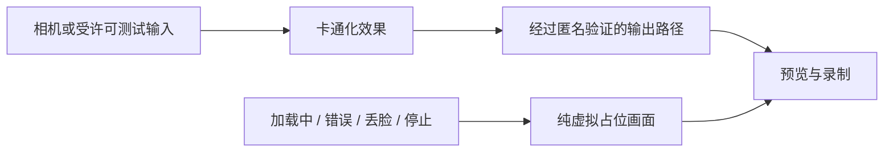

# Cartoon 3D Style：深入可行性与实施顺序

日期：2026-11-03。状态：完成第一轮深入调研及 SDK 公开接口静态检查，未运行新卡通化模型。

> 后续实测与新指令：用户要求保留星狐优化并同时研究本路线。DCT-Net 已真实运行、转换 ONNX，并在本地执行网页 WASM 后端；性能尚不满足网页实时。最新结果见[双线进展](LEARNER_AVATAR_TWO_TRACK_PROGRESS.md)。下文是实测前的可行性判断。

## 1. 用户已经确认的目标

用户看到 Snapchat `Cartoon 3D Style` 官方预览后明确说：“这就是我想要的效果，请深入研究。”**现在已有确认的视觉参照，停止继续推荐其他现成角色。** 原抖音截图的确切特效 ID 仍未知，这不影响以已确认预览为目标继续研究。

所需体验是：摄像头中的人实时呈现为柔和、细腻、具有三维动画质感的卡通人物；张嘴、眉眼和转头能自然传达。第一阶段不限定必须星狐，手臂仍暂缓。此前效果和匿名优先的要求继续有效。

建议将其作为**独立的神经卡通化实验**推进。Snap 创作工具是有条件的接入候选，自托管 DCT-Net 3D 是可独立进行的画质基线。两者都未获得“达到目标效果”的结论。

## 2. 重要结论

| 问题 | 当前结论 | 证据程度 |
|---|---|---|
| 是不是必须自己建一个精细三维角色？ | 同类效果可以通过实时机器学习图像转换实现，不要求我们的团队先建模 | Snap 官方确认技术类别；不代表其具体架构已公开 |
| 能直接调用已确认的 Cartoon 3D Style 吗？ | 不能仅凭公开特效 ID；尚未取得该 Lens 在 Camera Kit 内的使用权限 | 官方 FAQ 明确不提供全部 Snapchat 特效 |
| Camera Kit 是收费 SDK 吗？ | 官方当前公布可免费集成 Web/移动端；内容制作或授权费用另计 | 公开说明，非永久价格保证 |
| 能用参考图做自己的效果吗？ | Face Generator 有该工作流；其产物在 Camera Kit Web 的可用性未确认 | 功能页平台标注与通用 SDK 支持不能相互替代 |
| 可以用现有摄像头捕捉模块直接替换渲染器吗？ | 图像转换需要输入图像；当前 FaceFrame 参数不是等价输入 | SDK 输入接口与本地代码核查 |
| 能用最终 TTS 驱动嘴型吗？ | 没有发现可直接套用到神经卡通化 Lens 的通用系数接口 | 静态审阅；自有 Lens 可能定制，未证明 |
| 卡通化后是否匿名？ | 不能自动认定；可能保留脸型、头发、衣着和背景 | 路线属性，需画面与异常路径验证 |
| 安卓大屏能否使用？ | 有 Web 与原生 Android 路径，实际硬件/模型性能未测 | 官方能力 + 当前 Android 工程核查 |

## 3. 已确认效果的技术类别

[Snap 官方介绍](https://newsroom.snap.com/spotlight-1-year-anniversary)明确将 `Cartoon 3D Style` 描述为用机器学习实时将人转换为三维卡通风格。不能从“3D”名称推导出使用 ARKit 52、某个三维模型或某种特定 GAN；这些内部实现尚未取得第一方证明。

可以确定的方向差异：我们的旧方案依据少量检测参数扭动一张星狐图；神经卡通化接收图像，通过学到的外观映射生成画面。因此它有机会保留更多表演信息，但也可能出现牙齿异常、微表情被抹掉、侧脸失稳或逐帧闪烁，需要连续输入测试。

风格统一与人物身份统一是两个目标：“大家都变成同一种画风”并不等于“大家都变成同一个无法认出的角色”。第一轮必须把这两项分开记录。

## 4. Snap 路径：可以验证，但有两个先决条件

### 4.1 SDK 免费，目标 Lens 不自动随 SDK 提供

[2025 年官方公告](https://newsroom.snap.com/lens-fest-2025)与[2026 年 WebAR 说明](https://ar.snap.com/blog/guide-web-ar-camera-kit)均公布免费接入。当前[品牌要求](https://developers.snap.com/camera-kit/app-review/design-guide)对普通网页/移动应用不强制署名，商业公共大屏则有署名要求；不能仅按“是否电视”判断分类。

[Camera Kit FAQ](https://developers.snap.com/camera-kit/getting-started/faq)说明，除测试组外，需要自己创建或取得 Lens 内容。**本项目尚无目标 Lens 的接入授权，不复用公开演示的 token、不抓取或导出其模型。**

### 4.2 自制效果的工作流，以及兼容性缺口

[Face Generator](https://developers.snap.com/lens-studio/features/genai-suite/face-ml-generation)提供参考图/提示词、预览、训练和导入项目的流程，文档称一次训练可能需要最多约两小时。它可以减少手工绑定工作；账号可用性、具体额度/费用、本项目效果均未验证。

**关键发现：该页 Supported on 当前只列 Snapchat、Spectacles，并提示兼容性可能受限。** 不能据此断言产物一定不支持 Camera Kit，但也不能因为 Camera Kit 有 Web SDK 就承诺能用。

下一轮先取得一个有权使用的效果工程，在目标 SDK 和真实网页上通过验证，再调画风。普通人形卡通先证明质量与平台可用性，之后才试星狐；动物耳朵、毛发、参考图一致性需要独立测试。

另一条 Snap 工程途径是自行导入可授权模型：[SnapML](https://developers.snap.com/lens-studio/features/snap-ml/ml-overview)明确支持 Camera Kit 和 ONNX/TFLite。不过这只是模型运行基础设施，不附送目标卡通模型；还要满足[算子/设备兼容要求](https://developers.snap.com/lens-studio/features/snap-ml/compatibility)。

## 5. 实际 SDK 发布包检查

从 npm 官方注册表读取的版本为 **`@snap/camera-kit@1.22.0`**，包大小 1,099,013 字节；与注册表 SHA-512 完整性值匹配。归档 SHA-256：

`a9a4adb514e85e9b120c35e9f67572e3852b58c17896a9790fc60b8fa2eda509`

只在系统临时目录静态查看了公开声明与许可，没有安装到项目、执行 SDK 或启用相机。[检查记录](avatar-animation-phase-a/cartoon-style/sdk-audit.json)包含 12 项通过的声明检查、来源和文件摘要。它不构成运行时验证。

确认的接口事实：

- 支持相机流、视频、图片输入，可先用受许可输入做不打开相机的实验。
- 有 `live` 与 `capture` 两种输出画布。`capture` 用于对外呈现，但不自动承诺其中没有真人。
- 可以限制 FPS、释放 session、测平均 FPS 与模型帧处理耗时。SDK 的处理时长不等于摄像头到屏幕的端到端延迟。
- `LensExecutionError` 会自动移除 Lens；移除后仍播放时会直接输出输入画面。
- `launchParams` 是效果启动数据；视频的 `trackingData` 是未说明内部格式的 ArrayBuffer。它们不是现成的 `FaceFrame`/ARKit 表情输入通道。

官方[接入说明](https://developers.snap.com/camera-kit/integrate-sdk/web/web-configuration)可用于复核输入输出与生命周期；本次读取的公开兼容表仍只列到较旧的 Web 版本，不能自行推算 1.22.0 与最新 Lens Studio 的对应关系。

[Remote API](https://developers.snap.com/camera-kit/integrate-sdk/web/guides/remote-api)允许自有 Lens 和宿主在本地交换定制数据；但需要 Lens 主动发起请求和配套实现，不能据此控制无权修改的 Cartoon 3D Style，也没有证明可实时驱动其神经表情。

## 6. 匿名录课必须补的输出设计

官方示例是一般相机效果，不能直接当儿童匿名录制模板：没有效果、用户拒绝条款、运行中错误或主动移除效果，都可能使 SDK 管线显示输入图像。参见[条款提示说明](https://developers.snap.com/camera-kit/app-review/terms-of-service-notice)和公开接口检查。

计划中的架构为：

其中“匿名验证的输出路径”**尚未实现**。不能只盖一个 CSS 层，后台录制仍抓取会透出的 SDK 画布；也不能承诺只监听错误事件就一定挡住同帧露出。需在自有效果与宿主输出中设计可检查的保护，并逐帧验证异常切换。证明不了则不开放保存/发布。

还要区分“不保存相机视频”与“不向第三方传输”：SDK 会下载运行时、效果并有分析相关接口。没有实测网络流量前，不笼统声称第三方零通信、零数据。FAQ 对 TrueDepth 的本地处理说明不应扩展成全部 SDK/生成式功能的承诺。

## 7. 为什么最终配音是独立难点

[官方 Web 注意事项](https://developers.snap.com/camera-kit/integrate-sdk/web/guides/web-considerations)说明，SDK 输出画布不自带音频；[录制示例](https://developers.snap.com/camera-kit/integrate-sdk/web/guides/recording-video)只是将画布视频流录下来。

现有 Octos Learn 在讲课后生成最终旁白。若语速或内容改变，录制时的嘴型已经写进卡通视频，直接替换声音不会同步；全片简单变速也无法修正不同音素和停顿。

| 发布形式 | 与当前能力的关系 |
|---|---|
| 原始表演视频 + 原声 | 容易保持同步，但不符合当前合成声音目标，不采用为默认方案 |
| 表演视频 + 保持时序的变声 | 可以研究，但不是现有逐卡 TTS；需要语音质量、隐私与费用验证 |
| 最终 TTS + 独立口型重演 | 符合当前流程，需要另一个可靠的口型驱动/视频重配环节，尚未实现 |
| 参数轨迹 + 可被参数驱动的角色 | 现有播放器接入较自然，但目前没有证明目标神经效果支持这种形式 |

第一轮只验收画面。第二轮必须用一张真实课程卡片验证最终配音，否则“可直播”不能当成“学生课程闭环已完成”。播放同步继续复用 `AudioPlaybackClock`。

## 8. 自托管基线的实际核查

### DCT-Net 3D

[作者代码](https://github.com/menyifang/DCT-Net)提供三维卡通风格及视频逐帧处理。进一步读取[ModelScope 官方模型元数据](https://modelscope.cn/api/v1/models/iic/cv_unet_person-image-cartoon-3d_compound-models)：

- 模型为 `iic/cv_unet_person-image-cartoon-3d_compound-models`。
- 元数据标注 **Apache License 2.0**、TensorFlow、`master`，仓库存储 182,571,870 字节，约 174 MiB。
- 这是仓库存储总量，不是运行内存需求；未下载权重、未核对各文件与依赖许可、未测速度。

它提供了可以继续独立验证的路径，不依赖 Snap 账号。优先离线短片画质，再评估转换到本地/浏览器运行。现有 `onnxruntime-web` 不能自动运行 TensorFlow 模型，仍需要导出、算子与数值/画质一致性检查。

### 不应误列为立即可集成的项目

- [VToonify](https://github.com/williamyang1991/VToonify)：适合研究视频一致性，[代码许可](https://github.com/williamyang1991/VToonify/blob/main/LICENSE.md)限制非商业用途。它的公开 Hugging Face 演示在本轮访问显示 runtime error，不能让用户把它当成已可用体验入口。
- [AgileGAN 官方仓库](https://github.com/GuoxianSong/AgileGAN)：作者说明公司 IP 政策使模型、数据和训练代码未完整公开。论文的速度不能变成本项目能拿来运行的保证，也不能确定它就是目标 Lens 的内部实现。
- [TextToon](https://songluchuan.github.io/TextToon/)：有固定外观跨人驱动的研究展示，但当前未取得代码/权重/明确许可，保留线索，不排入确定交付。

## 9. 电脑与安卓大屏

网页初始验证可复用现有 React/TypeScript/Vite；通过点击才请求相机，明确 `audio:false`，停止与页面离开释放资源。Snap 路径自己处理图像时，不同时运行现有 MediaPipe 追踪，以免无谓增加负载。

[官方网页性能说明](https://developers.snap.com/camera-kit/integrate-sdk/web/guides/web-considerations)提醒 SnapML 效果在网页、移动和 Windows 上可能降帧，Lens Studio 预览不能代表网页。请求 720p 等常规输入，按实际相机设置验证尺寸；不能因为大屏显示 4K 就让模型推理 4K。

项目 Android 已有硬件加速、相机权限与可信来源的 WebView 授权桥接。这只能证明接入基础存在，未证明 Camera Kit 在该 WebView、GPU 和外接相机上正常运行。必要时再试[原生 Android 路径](https://developers.snap.com/camera-kit/integrate-sdk/android/android-configuration)，不能凭 Android 版本宣称兼容。

优先顺序：电脑生成/录制 → 大屏播放；大屏本地捕捉另测。首轮建议目标为 720p 输入、30 FPS 可见更新、端到端 p95 延迟不超过约 150 ms，连续 10 分钟观察内存/温度/丢帧。这是拟定验收门槛，尚无本项目测量值；失败时说明实际数据，不用重复帧或插帧包装实时性。

## 10. 儿童产品与发布条件

Camera Kit 和 Snapchat 用户账号规则不能混用。[Camera Kit 官方说明](https://developers.snap.com/camera-kit/app-review/terms-of-service-notice)确有美国 13 岁以下应用的额外选择和文件要求；不能因此推导所有地区儿童场景自动获准，也不能套用普通 Snap Kit 的笼统限制直接判定本产品一定不允许。

需要按真实受众与地区完成供应商确认、数据说明和应用审核。**当前不要求孩子注册 Snapchat 账号或上传人脸。** 开发者账号用于我们制作/管理效果，与孩子的产品账号分开。

[现行 Camera Kit 条款](https://www.snap.com/terms/snap-camera-kit)对 Lens 分发、对外分享和二进制缓存期限有要求，不能将 Lens 文件当永久可随课程分发的普通 GLB。网页/移动应用、公共大屏的品牌规则也要按具体用途确认。仅内部评估无需先完成正式上线，不绕过正式要求。

## 11. 与 M6 整合前的清单

当前 `services/learner-lessons/package-check.mjs` 仅接受 v1 课程包、课程/笔迹/MP3，32 MiB 上限；正式播放器目前是静态形象。这一轮不改现有学生录课主流程。

如果最终采用纯渲染视频：需要新包语义、媒体校验、逐卡时序、体积上限、旧包兼容和离线播放，而不是只加入视频扩展名。如果采用自有可驱动模型：需要角色版本、轨迹/口型能力及运行时分发规范。两种方案不可在未选定时混做。

## 12. 下一轮的具体工作与决策点

| 顺序 | 工作 | 可审阅交付物 | 继续条件 |
|---|---|---|---|
| P0a | Snap 目标内容与 Web 兼容性预检 | 一个有权使用的自有 Lens，实际 Camera Kit Web 加载结果、确切版本 | 不是只在 Snapchat 中有效；没有挪用公开 Lens 或 token |
| P0b | DCT-Net 权重/依赖与环境预检 | 固定模型版本、许可清单、隔离环境与一帧结果 | 不改当前运行环境；不将任何截图上传推理服务 |
| P1 | 同一受许可成人/合成输入的 20–30 秒连续画质验证 | 自然、三档张嘴、圆唇、眨眼、眉毛、左右/上下转头、返回正面；输出耗时与边界记录 | 实际动画符合用户确认画风，表情与边缘可接受 |
| P2 | 匿名路径与异常验证 | 多人输入外观一致性、背景、丢脸、多人入镜、失败、停止/重开逐帧检查 | 录制中零真人帧，且身份呈现符合目标 |
| P3 | 最终配音与一张课程卡片 | 生成最终声音后的嘴型短片，暂停/跳转/倍速 | 有可用的最终配音同步方案 |
| P4 | 产品与安卓适配 | 两处正式播放器与课程包、目标大屏实测 | 前述质量、授权、运行条件均通过 |

P0a 需要我们自己的 Snap 开发者账号、相应 token 与可用 Lens；目前没有拿到，不能宣称已能运行。P0b 可继续独立推进，不需要用户测试设备。研究授权不等于付费训练/联系供应商授权；如走到这些步骤，应先提供具体内容、数据范围与费用供决定。

## 本轮实际完成

完成：用户确认目标的记录、第一方资料与当前条款核查、官方 SDK 发布包完整性验证、12 项静态接口检查、DCT-Net 官方权重元数据核对、本地工程整合点与分阶段验收方案。

未完成：运行 Snap 效果、训练自有 Lens、下载/运行 DCT-Net 权重、实际连续动画与帧率、匿名保证、最终配音、安卓实机。没有注册账号、联系第三方、付费、启用摄像头、部署或修改产品依赖。
