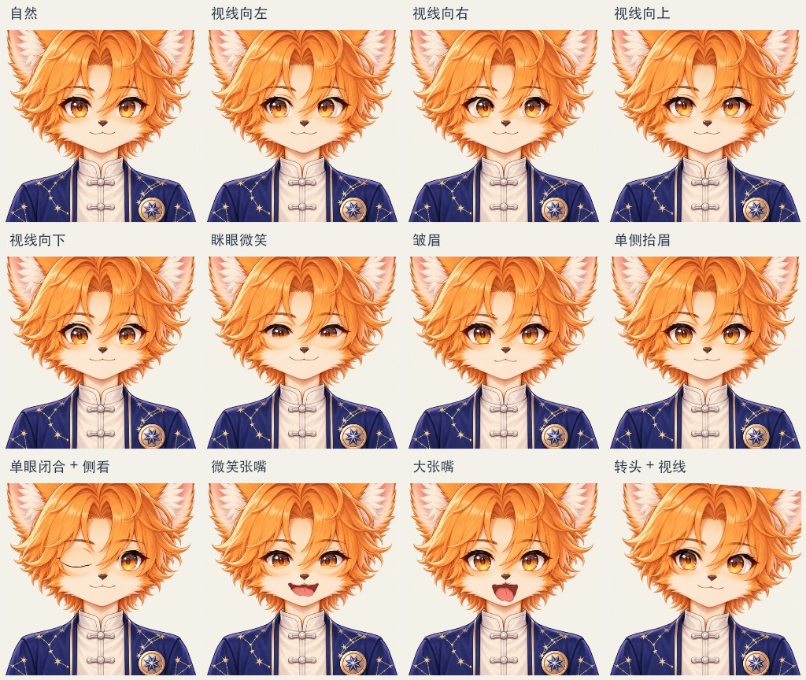
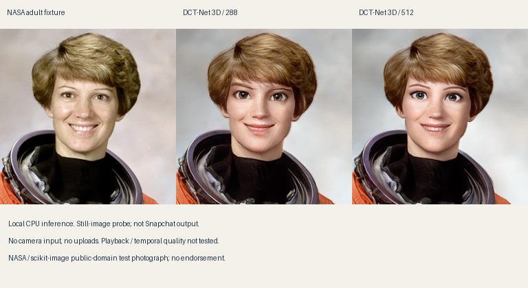

# 双线推进：星狐优化与神经卡通化实验

日期：2026-11-03。用户最新指令：“目前已经做好的星狐继续优化，同时研究类似 Snap Cartoon 3D Style。”两条线都继续，研究线不替换现有星狐。

## A. 星狐：本轮已实现

当前本地 `/teach/avatar-2d` 已接入以下变化，保留同一套 `painted-v0.2` 原画与原有头部运动约束：

- 左右、上下视线。分离虹膜与眼白的绘画残差，移动虹膜时保留眼线、眼皮与周围毛发；原位露出的区域由眼白补足。视线限制在眼眶内。
- 眯眼/笑眼：消费现有 `eyeSquint` 和 `cheekSquint` 通道。笑眼主要从下眼睑抬起，与闭眼动作分开；首次小样把眯眼等同半闭眼，显得困倦，视觉检查后已修正。
- 内外眉独立变化与下压，支持单侧抬眉、皱眉；左右嘴角分别响应微笑和下压。
- 手动控制新增视线、眯眼、嘴角下压、皱眉；增加四个定格检查按钮，中文/英文消息同步。摄像头已有通道会经过同一绘制器；手动录制/回放也保留这些参数。

实际产品绘制器输出：



- [此前 / 本轮 10 秒动作对照](avatar-animation-phase-a/expressions-v1/comparison.gif)：同一原画、同一组合控制参数；此前绘制器取自 `51acb03f`。
- [像素检查报告](avatar-animation-phase-a/expressions-v1/report.json)。

该动画是**合成控制参数驱动真实绘制器**，没有用生成图片替代程序输出，也不是新的摄像头录制。

### 代码与检查

- `src/learning/avatar/painted-eyes.ts`：虹膜/眼白残差与眼眶遮挡、独立笑眼和眨眼。
- `painted-fox.ts`：视线通道映射、来源增益、眉毛与左右嘴角联动。
- `avatar-lab-page.tsx` 和中英消息：新增操作与定格。
- `scripts/avatar-expression-validate.ts`：从 Git 加载旧绘制器，对比真实 Canvas 输出。

40 项相关测试通过：表情映射、原有平滑/校准、手动录制回放与舞台生命周期。TypeScript、改动文件 ESLint、i18n 检查、正式构建通过。构建仍有未改动样式/包体的提示。

实际像素检查：自然表情与源图、复位、眼外区域、闭眼后的视线隔离、另一只眼睛独立性、无效输入恢复均为零最大差值；小量输入无突跳。虹膜棕色区域重心从左看约 194.02 → 自然 198.56 → 右看 202.40，验证移动方向，**不是捕捉准确率分数**。

边界：仍不是完整 Live2D/三维角色；没有新增侧脸或头发物理；源图顶部裁切仍存在。未实现全部检测通道。头发/耳朵的刚性随动与先前扩大嘴部行程继续保留。本轮没有重新开启相机、验证真人视线方向/灵敏度或测浏览器/电视帧率，美术满意度仍需用户判断。

## B. 神经卡通化：本轮从调研推进到真实推理

已在隔离目录 `scratch/avatar-cartoon/` 准备环境并运行官方 DCT-Net 3D 冻结推理图，不需要 Snap 账号。没有改产品依赖、请求相机、上传图片推理或使用云算力。

输入是 scikit-image 官方公开样例中 NASA 的成人肖像，[来源说明](https://scikit-image.org/docs/stable/api/skimage.data.html#skimage.data.astronaut)标注公共领域。它只是实验输入，不代表该人物认可产品，也不是产品形象候选。



左侧是固定裁剪后的输入，中间/右侧是 288/512 输入尺寸的真实模型输出。它不是 Snapchat 模型，也不是本项目生成的概念画。

### 模型与环境

- 来源：`iic/cv_unet_person-image-cartoon-3d_compound-models`，官方模型卡标注 Apache License 2.0。
- **最小核心推理图只有 5,894,895 字节**；此前约 174 MiB 是整个仓库的存储总量，包含训练等文件，本轮没有全量下载。
- 下载了推理图、配置和说明，三份文件均与官方文件列表 SHA-256 匹配。[文件来源清单](avatar-animation-phase-a/cartoon-style/dct-probe/model-manifest.json)。
- 固定人工裁剪，未运行上游检测、自动对齐和背景合成，所以没有冒充完整管线测试。
- 输入是 HWC BGR、float32、0–255；输出 uint8。首次 ONNX 适配误用 uint8 输入，运行时拒绝；修正为真实模型声明后通过。
- TensorFlow 2.16.2；ONNX Runtime 1.19.2；tf2onnx 1.16.1；Apple Silicon CPU、原生六线程。完整依赖见[隔离环境清单](avatar-animation-phase-a/cartoon-style/dct-probe/requirements.txt)。

### 本轮实测（仅核心图）

先结束其他推理任务，再串行重跑原生与 WASM 计时，避免两个测试同时抢占 CPU。每项有预热与多个测量样本，原始值保留在报告中。

| 路径 | 输入 | 中位耗时 | 验证范围 |
|---|---|---|---|
| TensorFlow / CPU | 288×288 | 约 66 ms | 真实核心模型推理 |
| TensorFlow / CPU | 512×512 | 约 182 ms | 同一头部裁剪 |
| ONNX Runtime / CPU | 288×288 | 约 71 ms | 与 TensorFlow 输出比对 |
| ONNX Runtime / CPU | 512×512 | 约 197 ms | 同一头部裁剪 |
| onnxruntime-web / WASM，单线程 | 288×288 | 约 392 ms | 在 Node 执行网页 WASM 后端，**不是浏览器实测** |

ONNX 转换成功，模型约 5.89 MB；三组原生对比和一组 WASM 对比，8-bit 输出最大相差 1 个色阶。这是数值迁移检查，不是卡通画质评分。

- [原生推理与 ONNX 比对](avatar-animation-phase-a/cartoon-style/dct-probe/report.json)
- [网页 WASM 后端计算检查](avatar-animation-phase-a/cartoon-style/dct-probe/wasm-report.json)

结论：已证明可以在本机得到该方向的真实卡通化图像，也证明这个图能在网页使用的 WASM 后端计算。**当前单线程 WASM 不适合实时摄像头跟随。** 核心计算还不包括捕捉、检测/对齐、背景处理、编码和显示，不能把上述耗时倒数当成完整应用帧率。尚未验证 WebGPU、Core ML 或安卓 GPU。

### 画面观察与未通过项

- 能看到平滑皮肤、放大的眼睛和三维卡通化五官，但尚未证明达到用户确认的 Snapchat 质感。
- 同一肖像在不同输入尺寸的风格强度有变化；连续实验要固定处理尺寸和稳定人脸区域，避免尺度变化造成风格跳动。
- 发型、衣服和环境仍保留，人物也仍可辨认。**此结果不满足固定匿名角色要求。**
- 本轮为静态输入，不能评价张嘴行程、快速闭眼、转头、闪烁和时间一致性；更没有验证最终 TTS 嘴型。

### 复现

依赖与模型留在忽略的 scratch，不进入产品包。模型文件下载地址与哈希见清单；转换使用官方 tf2onnx GraphDef 路径：

```sh
scratch/avatar-cartoon/venv/bin/python -m tf2onnx.convert \
  --graphdef scratch/avatar-cartoon/model/cartoon_h.pb \
  --inputs input_image:0 --outputs output_image:0 --opset 17 \
  --output scratch/avatar-cartoon/model/cartoon-3d.onnx

scratch/avatar-cartoon/venv/bin/python scripts/avatar-cartoon-probe.py \
  --model scratch/avatar-cartoon/model/cartoon_h.pb \
  --input scratch/avatar-cartoon/astronaut.png \
  --output docs/avatar-animation-phase-a/cartoon-style/dct-probe \
  --onnx scratch/avatar-cartoon/model/cartoon-3d.onnx

node scripts/avatar-cartoon-wasm-probe.mjs /private/tmp/octos-2d-preview \
  scratch/avatar-cartoon/model/cartoon-3d.onnx
```

Node 需使用本项目支持的版本，本轮为 22.23.3。最后一个脚本的首参是已安装 `@napi-rs/canvas` 的独立绘图工具目录，换机器时需重新准备，不能假设临时目录永远存在。

## 双线下一步

| 星狐线 | 神经卡通化线 |
|---|---|
| 用已有参数片段检查视线、眉眼与嘴型组合的自然度，继续修正局部残差/遮挡 | 同一处理尺寸的连续成人/合成动作输入，检查嘴型、转头和闪烁 |
| 下一轮关注圆唇/张嘴的形状与脸颊联动，保留中性画风，不继续放大头部变形 | 验证 WebGPU 等加速与数值/画质一致性；WASM 目前仅作正确性基线 |
| 真人捕捉灵敏度和安卓性能仍待后续设备验证，不要求用户现在操作 | 继续调查 Snap 自有效果的授权及 Web 兼容性，独立于自主模型实验 |
| M6 正式播放器与课程包接入仍未完成 | 固定匿名外观和最终配音是后续独立门槛，参见深入可行性报告 |

本轮产物只在头像开发分支，未创建 PR、推送、合入 main 或部署。此前已推送工作与未推送提交状态见原交接；本轮没有改变这些 Git 引用。
