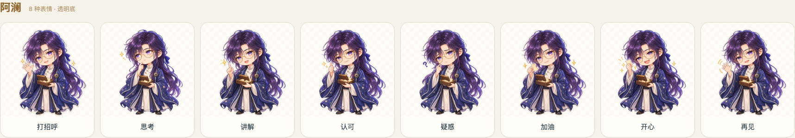
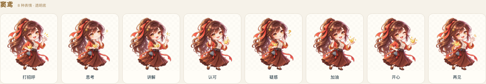
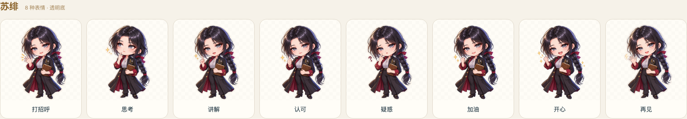

# 三位老师 Q 版表情素材（2026-10-30）

用户已确认三张 Q 版样例，授权沿同一方向为每位老师扩成一套。每人八张，共 24 张：打招呼、思考、讲解、认可、疑惑、加油、开心、再见。包含原来认可的三张样例，新增 21 张；整套变体已完成作者检查，未将样例批准写成用户对每张新变体的验收。

人物身份、服装与画风锁定于已确认的 Q 版样例；阿澜温柔儒雅、窦鸢灵动、苏绯沉稳。每张独立透明底，无文字，保留暖白贴纸轮廓；疑惑使用小问号符号。尚未确定产品用途，因此只归档素材，没有增加页面入口、替换课堂胸像或改变老师行为。

## 预览

阿澜：

窦鸢（内部 id 仍为 doudou）：

苏绯：

## 文件与复用

- 仓库保存 [512px 透明 WebP 与清单](teacher-art/2026-10-30/chibi/manifest.json)，24 张共 1,965,606 字节，位于 `docs/teacher-art/2026-10-30/chibi/<teacher-id>/<expression>.webp`。素材未放入 public，不增加运行时构建内容。
- 原尺寸 1254 × 1254 透明 PNG、512px WebP、可切换深浅背景的 `index.html`、总览截图和 ZIP 位于本机忽略目录 `delivery/teacher-chibi-2026-10-30/`；PNG 共 41,328,997 字节。原始生成图另保留在工具默认目录，未删除。
- [完整提示词与参照图记录](teacher-art/2026-10-30/chibi/prompts.json)；[文件清单与 SHA-256](teacher-art/2026-10-30/chibi/manifest.json)。使用内置 image_gen，每个新表情独立调用；没有使用 CLI、本人模型配置或语音凭据。WebP 只做缩放与编码，没有通过脚本重绘或修改人物。
- 八个文件名依次为 `greeting`、`thinking`、`explaining`、`approval`、`confused`、`encouragement`、`happy`、`goodbye`。各老师相同名称表达同一类用途。

## 实际验证与边界

24 张均检查真实 alpha 通道及图像尺寸；浏览器确认全部 WebP 加载，深浅背景切换正常，390px 页面无横向溢出，无页面错误。逐组检查人物一致性、表情区别和透明边缘。初版素材校验误把最大 alpha 为 254 的图片判为不透明错误，已改为允许近乎完全不透明的主体并重新通过，图片本身未因此改动。

用户程序验收及合并授权见 [美术更新记录](TEACHER_ART_REFRESH.md)；相关 [PR #112](https://github.com/octos-org/octos-learn/pull/112) 合并状态以 GitHub 为准。没有部署，未做 Android 实机验收。
